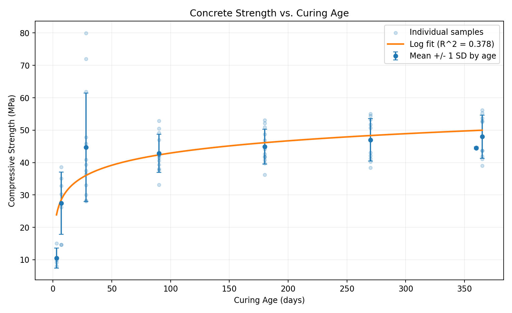
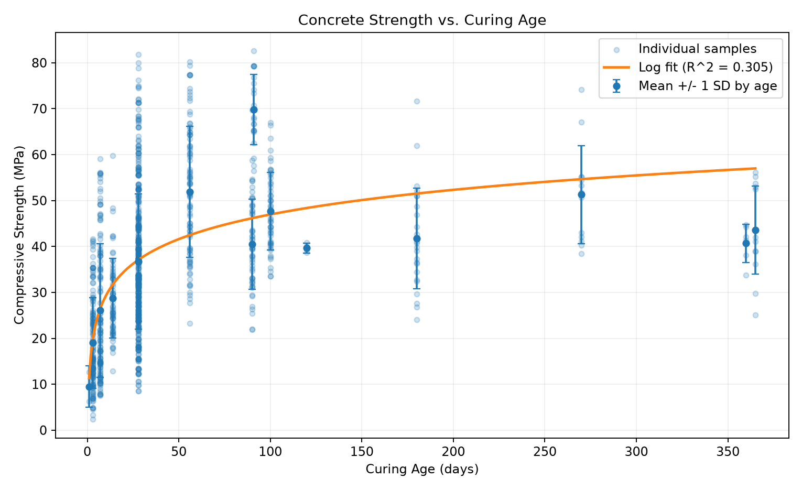
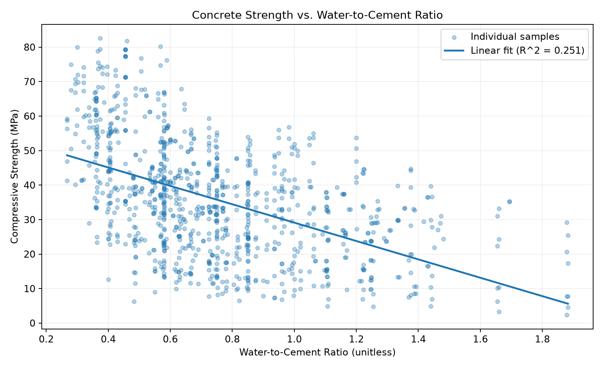
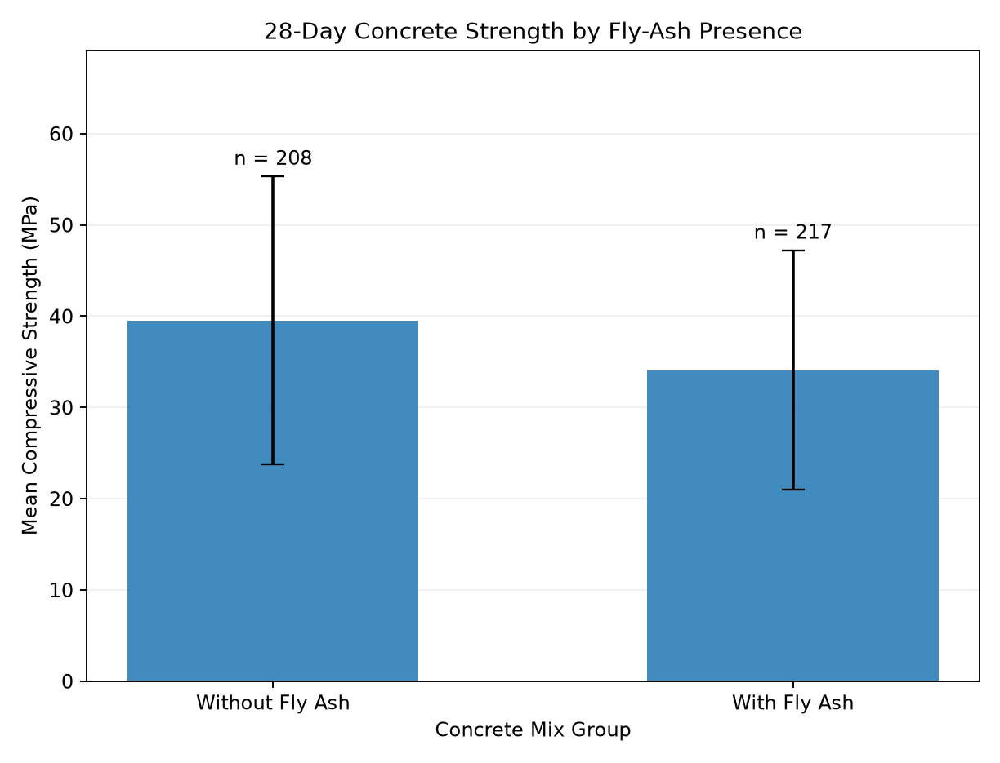

# How Concrete Mix Design and Curing Affect Compressive Strength

**ENGR 315 Computational Methods in Engineering — Team 33**  
**Contributors:** Dylan Wagner and Mitchell Kim  
**Phase II: Sub-Task 6 — Python Analysis and Progress Report**

## Objective and Motivation

Concrete compressive strength matters in structural and civil engineering. The goal of this project is to identify relationships between concrete curing time, mix composition, and compressive strength by applying statistics and curve fitting in Python.

## Dataset

**Primary source:** [Concrete Compressive Strength — UCI Machine Learning Repository](https://archive.ics.uci.edu/dataset/165/concrete+compressive+strength), attributed to I-Cheng Yeh (1998), DOI: [10.24432/C5PK67](https://doi.org/10.24432/C5PK67), available under CC BY 4.0. The complete dataset has **1,030 samples** with ingredient amounts (kg/m³), curing age (days), and compressive strength (MPa). The project scripts download a comma-separated copy of this dataset from [this public GitHub mirror](https://github.com/HansenHan/ML_UCI_Concrete_Compressive_Strength/blob/main/Concrete_Data.csv) when executed online. The `data/concrete.csv` file normally contains the complete downloaded dataset; `data/example_first_70_age_strength.csv` is **not the full dataset**. The full-results outputs and figures linked below are generated from all 1,030 records. The scripts retrieve the original source CSV if it is not already present.

## Questions and Methods

| Question | Calculations | Visualization |
| --- | --- | --- |
| 1. How does curing age relate to compressive strength? | Average strength and standard deviation by age; Pearson correlation; logarithmic curve fit and R² | Individual observations, group means ± SD, fitted logarithmic curve |
| 2. How does water-to-cement ratio relate to compressive strength? | Compute water / cement; linear regression; Pearson r; R²; slope and p-value | Scatterplot with regression line |
| 3. How does 28-day strength compare with and without fly ash? | Filter to exactly 28 days; mean, SD, and count by group; Welch's independent-samples t-test | Mean strength by group with SD error bars |

All values are descriptive unless otherwise indicated; other mixture ingredients can affect the relationships observed. A statistical association does not establish causation.

## Implementation Details

- **`prepare_data.py`** downloads the complete public dataset, if it is not already present.
- **`q1_curing_age.py`** loads curing age and strength, groups data by age, computes metrics and a logarithmic least-squares fit, and saves a plot.
- **`q2_water_cement.py`** calculates the water-to-cement ratio and a linear regression, and saves a plot.
- **`q3_fly_ash.py`** filters concrete to exactly 28 days, compares fly-ash groups, and saves a plot.
- **`run_all.py`** downloads data, runs all three analyses, records the printed terminal output to the `results/` directory, and inserts the full results and plots into this README.
- **`update_readme.py`** updates only the results section between the marked lines, preserving other README content.

## How to Run

In a terminal opened in the project folder:

```bash
python -m pip install -r requirements.txt
python run_all.py
```

This writes `results/q1_curing_age_output.txt`, `results/q2_water_cement_output.txt`, `results/q3_fly_ash_output.txt`, and three labeled PNG plots under `plots/`. It also updates the **Results** and **Conclusions** sections of this README with all command-line output and graphs. The full-dataset results, plots, and console outputs shown below have now been generated. Run this again to reproduce the results from the source dataset.

To see a preliminary test of Question 1 using only the first 70 authentic rows from the UCI copy, run:

```bash
python q1_curing_age.py --data data/example_first_70_age_strength.csv --plot example_first_70_q1.png
```

This is a **limited test**, not the complete dataset or final project findings.

## Preliminary Progress — Question 1 (70-Row Test Only)

The script was successfully exercised using the first 70 source observations for curing age and strength. For these **70 source rows**, Pearson correlation was **r = 0.4213** and the logarithmic fit had **R² = 0.3785**. Mean compressive strength was **10.53 MPa at 3 days** (4 observations) and **47.99 MPa at 365 days** (10 observations). This limited slice shows a positive age-strength association, but the large spread between mixes means curing age alone does not explain the results. These 70 samples are not a random sample of the full dataset, so these values should **not** be interpreted as the final 1,030-record findings.

**Example terminal output:** [results/example_first_70_q1_output.txt](results/example_first_70_q1_output.txt)



<!-- BEGIN GENERATED RESULTS -->
## Results (Full UCI Dataset)

### Question 1: Curing Age

Command-line output:

```text
QUESTION 1: How does curing age relate to compressive strength?
Number of concrete samples: 1030
Pearson correlation (age vs. strength): r = 0.3289
Logarithmic fitted curve (age > 0): strength (MPa) = 11.3110 + 7.7423 ln(age in days)
Coefficient of determination for logarithmic fit: R^2 = 0.3049

Strength grouped by curing age:
 Age (days)    Count   Mean (MPa)    Std (MPa)
          1        2         9.46         4.50
          3      134        18.98         9.86
          7      126        26.05        14.58
         14       62        28.75         8.64
         28      425        36.75        14.71
         56       91        51.89        14.31
         90       54        40.48         9.82
         91       22        69.81         7.70
        100       52        47.67         8.40
        120        3        39.65         1.10
        180       26        41.73        10.93
        270       13        51.27        10.64
        360        6        40.70         4.17
        365       14        43.56         9.62

Plot saved: plots/q1_curing_age.png
Interpretation: The raw correlation is descriptive; differences in mix design may confound the age relationship.
```



### Question 2: Water-to-Cement Ratio

Command-line output:

```text
QUESTION 2: How does water-to-cement ratio relate to compressive strength?
Number of concrete samples with positive cement content: 1030
Mean water-to-cement ratio: 0.7483 (unitless)
Pearson correlation: r = -0.5007
Regression line: strength (MPa) = 55.7502 + -26.6379 * water/cement ratio
Coefficient of determination: R^2 = 0.2507
Slope: -26.6379 MPa per 1.0 unit of water/cement ratio
Two-sided slope p-value: 1.86e-66

Plot saved: plots/q2_water_cement.png
Interpretation: This is a raw association; the cement ratio is not adjusted for supplementary binders or sample age.
```



### Question 3: Fly Ash at 28 Days

Command-line output:

```text
QUESTION 3: How does average 28-day strength compare with and without fly ash?
Total samples cured for exactly 28 days: 425
Without fly ash: n = 208, mean = 39.54 MPa, SD = 15.76 MPa
With fly ash:    n = 217, mean = 34.07 MPa, SD = 13.12 MPa
Mean difference (with - without): -5.47 MPa
Welch two-sample t-test: t = -3.8776, p = 0.0001232

Plot saved: plots/q3_fly_ash.png
Interpretation: Differences between groups do not prove the effect of adding fly ash, because mix ingredients also vary.
```



## Conclusions (Full UCI Dataset)

1. **Curing age:** Across 1030 samples, age and compressive strength have a positive Pearson correlation (r = 0.329). The logarithmic trend and age-specific standard deviations should be considered together; mix compositions also vary.
2. **Water-to-cement ratio:** The association is negative (r = -0.501, R² = 0.251). This is an unadjusted regression, not a prediction controlling for other mixture ingredients.
3. **Fly ash at 28 days:** The fly-ash group's mean strength is -5.47 MPa relative to the no-fly-ash group. The Welch test shows evidence of different group means (p < 0.05) (p = 0.0001232). This group comparison cannot isolate the causal effect of fly ash.

**Overall limitation:** The mixes differ in cement, water, curing age, and other ingredients. These results describe associations in the dataset, not controlled experiments.

<!-- END GENERATED RESULTS -->

## Actions That Need to Be Completed

- [x] Define three question/method pairs and prepare Python code for all three.
- [x] Include a checked, limited test for Question 1 and its actual console output and plot.
- [x] Run the full 1,030-sample analysis, generate all final results and plots, and update the README.
- [x] Review the plots and conclusions for each question; note mixture composition as a possible confounder.
- [ ] Commit/push the final scripts, README, dataset, console outputs, and plots to Team 33's GitHub repository.
- [ ] Submit **Team 33's own project GitHub repository URL** in Canvas.

## References

1. Yeh, I. (1998). *Concrete Compressive Strength* [Dataset]. UCI Machine Learning Repository. https://doi.org/10.24432/C5PK67
2. Public CSV mirror of the UCI dataset: https://github.com/HansenHan/ML_UCI_Concrete_Compressive_Strength/blob/main/Concrete_Data.csv
3. JMU ENGR 315 Project Description (attached to assignment).